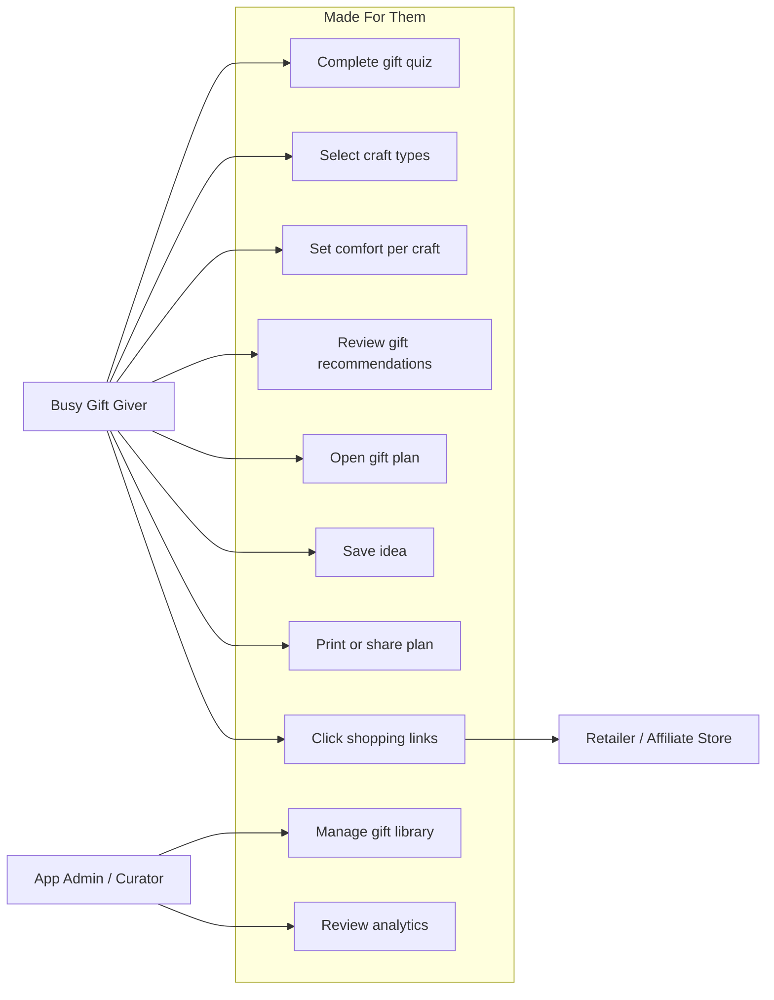
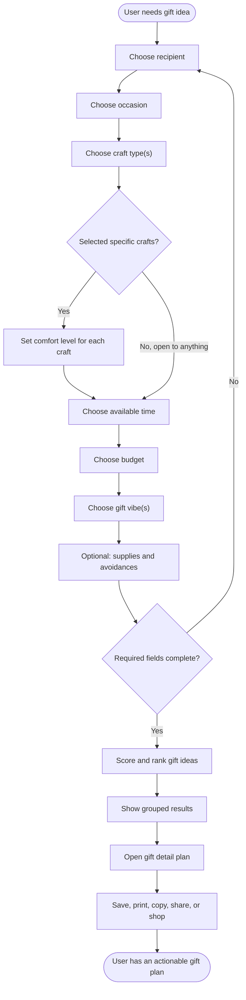
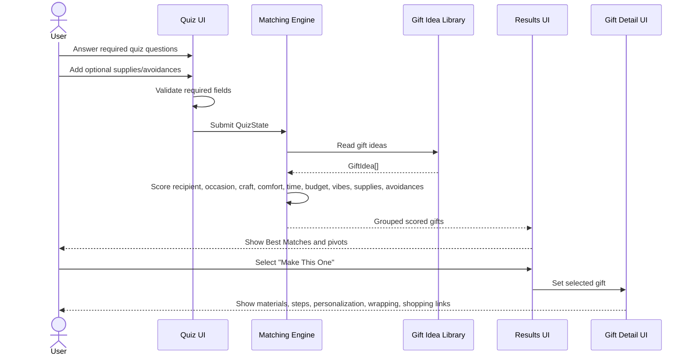
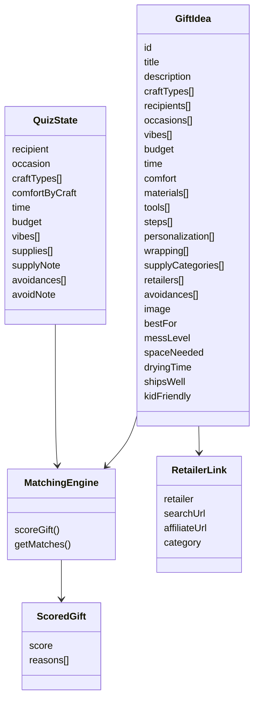
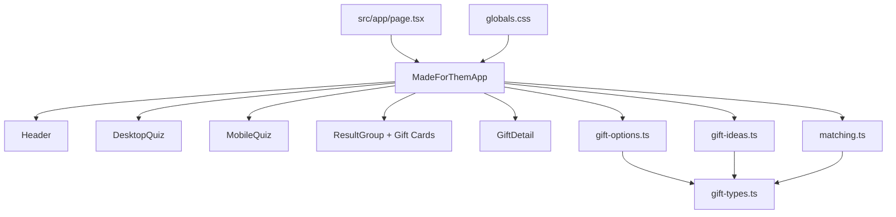
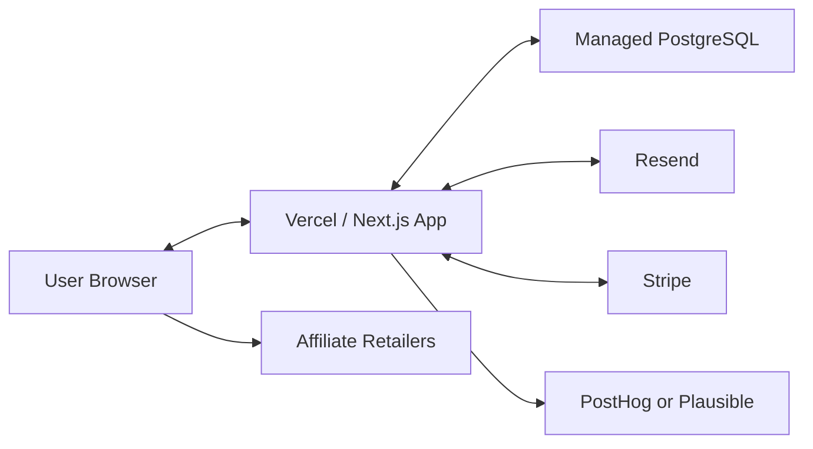

# Made For Them Action Plan

Made For Them is a warm, premium DIY gift idea generator for busy people who want a thoughtful handmade gift fast. Users answer a conversational quiz, select the craft types they want to make, set comfort levels per craft, and receive curated gift ideas with materials, steps, personalization, wrapping, and shopping links.

## Current Prototype Status

Implemented:

- Next.js, React, TypeScript, Tailwind CSS prototype.
- Responsive hybrid quiz: desktop single-page form, mobile guided flow.
- Craft type multi-select.
- Expandable comfort level per selected craft.
- Required quiz questions 1-7 and optional questions 8-9.
- 33 starter gift ideas with metadata.
- Matching logic for result ranking.
- Results sections and gift detail plan.
- Gift tag favicon/app mark.
- Project-specific visual assets.
- Supabase PostgreSQL storage, Drizzle migrations, and PGlite development support.
- Private owner editor with drafts, publishing checks, and stale-edit protection.
- Detailed crochet patterns and printable/copyable gift plans.

Verified:

- `pnpm lint`
- `pnpm build`
- `pnpm test:db` (24 tests).
- Desktop and mobile workflow smoke test.

## Product Decisions

| Area | Decision |
| --- | --- |
| Brand name | Made For Them |
| Audience | Busy people who need a thoughtful handmade gift fast |
| Tone | Warm and sentimental, but premium |
| Occasion scope | Any occasion from day one |
| Visual style | Clean editorial stationery with handmade accents |
| Quiz voice | Soft and conversational |
| Results style | Desktop polished grid, mobile curated magazine list |
| Gift detail style | Project plan with recipe-card warmth |
| Starter library | Beginner-friendly with a few impressive-but-doable ideas |

## Actionable Roadmap

### Phase 1: Prototype Foundation

Goal: Make the core product usable enough to test the concept.

Status: Mostly complete.

Tasks:

- [x] Scaffold Next.js project.
- [x] Build brand foundation.
- [x] Build responsive quiz.
- [x] Add craft-specific comfort levels.
- [x] Add starter gift idea library.
- [x] Add matching logic.
- [x] Build results and gift detail views.
- [x] Add local visual asset.
- [x] Verify lint/build.
- [x] Add individual project images.
- [ ] Add stronger empty state for strict filters.
- [ ] Add local saved ideas persistence.

Acceptance criteria:

- User can complete quiz on desktop and mobile.
- User sees relevant results.
- User can open a gift plan.
- User can print, copy, share, and save ideas.
- No broken images or layout overflow.

### Phase 2: Content Quality

Goal: Make recommendations feel abundant, specific, and trustworthy.

Tasks:

- [ ] Expand gift library from 33 to 100 ideas.
- [ ] Add category-specific images for paper, crochet, food, candles, jewelry, fabric, Cricut, wood, clay, floral, and upcycled gifts.
- [ ] Add "make it faster" variants.
- [ ] Add "make it cheaper" variants.
- [ ] Add "make it more personal" variants.
- [ ] Add gift safety notes where needed, especially candles, food, bath products, and tools.
- [ ] Add better shopping category mapping.
- [ ] Add seasonal collections.

Acceptance criteria:

- At least 8 strong matches appear for common quiz combinations.
- Each result has clear reason-to-believe copy.
- Gift detail pages feel actionable without external research.
- Starter images match craft category and premium brand style.

### Phase 3: Product Polish

Goal: Make the app feel like a polished consumer product.

Tasks:

- [ ] Add saved ideas using `localStorage`.
- [ ] Add filter pivots that actually re-rank results.
- [x] Add printable gift plan layout.
- [x] Add feedback for copy/share actions.
- [ ] Add "loosen filters" suggestions when results are weak.
- [ ] Add better mobile accordions on gift detail.
- [ ] Add accessibility pass for focus states and labels.
- [ ] Add responsive QA screenshots to repeat before releases.

Acceptance criteria:

- App feels responsive and clear on mobile, tablet, laptop, and desktop.
- All visible actions produce feedback.
- Main flows are keyboard accessible.
- Text does not overlap, overflow, or become unreadable.

### Phase 4: Data And Monetization Foundation

Goal: Prepare for growth without overbuilding too early.

Tasks:

- [x] Add local PostgreSQL storage, migrations, gift import, and server-side library loading.
- [x] Connect and verify hosted PostgreSQL through Supabase (local app).

Local implementation and Supabase setup walkthrough: [Database Setup](database-setup.md).

Remaining tasks:
- [x] Choose Supabase for managed PostgreSQL.
- [x] Add Drizzle.
- [ ] Add affiliate link tracking model.
- [ ] Add analytics events.
- [ ] Add email capture for saved plans.
- [x] Add a single-owner gift editor with drafts, publication checks, and protected saves.

Editor implementation and owner setup: [Admin Editor](admin-editor.md).

Acceptance criteria:

- Gift ideas can be added without code edits.
- Affiliate clicks can be tracked.
- Quiz completion and result click behavior can be measured.
- Email capture is optional and does not block the quiz.

### Phase 5: Personalization

Goal: Expand personalization using curated project data and clear matching rules.

Tasks:

- [x] Explain why projects fit and identify tradeoffs.
- [ ] Add gift plan refinements for faster and lower-cost variants.
- [ ] Add "use supplies I have" personalization.
- [ ] Expand the curated gift library through the owner editor.
- [ ] Add content review checks before publication.
- [ ] Add saved preferences when user accounts are introduced.

Acceptance criteria:

- Matching explanations help users choose a realistic project.
- The curated database remains the source of truth.
- Project variants have concrete instructions and material lists.
- Content can be reviewed before they appear in recommendations.

### Phase 6: Launch

Goal: Launch with a focused, searchable use case.

Tasks:

- [ ] Create SEO pages for high-intent occasions.
- [ ] Start with "last-minute thoughtful gifts under $25".
- [ ] Add Pinterest-friendly pages and images.
- [ ] Add basic analytics.
- [ ] Add feedback capture.
- [ ] Add first affiliate programs.
- [ ] Write launch checklist.

Acceptance criteria:

- Visitors can understand the app in under 10 seconds.
- Quiz completion rate is measurable.
- Top gift result clicks are measurable.
- Affiliate links are clearly useful, not spammy.

## UML: Use Case Diagram



## UML: Quiz Activity Diagram



## UML: Matching Sequence Diagram



## UML: Data Model Class Diagram



## UML: Frontend Component Diagram



## UML: Future Deployment Diagram



## Mockup: Desktop Home / Generator

```text
+--------------------------------------------------------------------------------+
| [gift tag] Made For Them        Gift Generator  Idea Library  Gift Plan  Saved |
+--------------------------------------------------------------------------------+
|                                                                                |
|  Make Something That Feels Like Them        Curated Preview                    |
|  Answer a few questions...                  +------------------------------+  |
|                                             | image | Memory Jar...        |  |
|  +--------------------------------------+   |       | tags: $0-10 / 30 min |  |
|  | Gift Brief                     14%   |   +------------------------------+  |
|  | progress line                        |   +------------------------------+  |
|  | Who are you making this for?         |   | image | Pressed Flowers...   |  |
|  | [Partner] [Parent] [Friend] ...      |   +------------------------------+  |
|  | What are we celebrating...?          |   +------------------------------+  |
|  | [Birthday] [Thank you] ...           |   | image | Coupon Book...       |  |
|  | What would you enjoy making?         |   +------------------------------+  |
|  | [Open] [Crochet] [Paper] ...         |                                     |
|  | Comfort expands per selected craft   |                                     |
|  | Time / Budget / Vibe                 |                                     |
|  | Optional supplies / avoidances       |                                     |
|  | [Find Their Gift]                    |                                     |
|  +--------------------------------------+                                     |
+--------------------------------------------------------------------------------+
```

## Mockup: Mobile Guided Quiz

```text
+----------------------------------+
| [tag] Made For Them        [menu] |
+----------------------------------+
| Make Something That Feels        |
| Like Them                        |
| Short supporting copy wraps here |
|                                  |
| +------------------------------+ |
| | Step 1 of 9          14%     | |
| | progress line                | |
| |                              | |
| | Who are you making this for? | |
| | [Partner]                   | |
| | [Parent]                    | |
| | [Friend]                    | |
| | [Child]                     | |
| | [Teacher]                   | |
| |                              | |
| | [Back]        [Next]         | |
| +------------------------------+ |
+----------------------------------+
```

## Mockup: Results Page

```text
+--------------------------------------------------------------------------------+
| A Few Thoughtful Ideas For Them                         [Fastest] [Personal]    |
| Based on your time, budget, craft choices...             [Uses what I have]     |
|                                                                                |
| Best Matches ---------------------------------------------------------------   |
| +----------------+ +----------------+ +----------------+ +----------------+   |
| | image          | | image          | | image          | | image          |   |
| | Memory Jar     | | Coupon Book    | | Emergency Kit  | | Tea Blend      |   |
| | why it fits... | | why it fits... | | why it fits... | | why it fits... |   |
| | tags           | | tags           | | tags           | | tags           |   |
| | [Make This]    | | [Make This]    | | [Make This]    | | [Make This]    |   |
| +----------------+ +----------------+ +----------------+ +----------------+   |
+--------------------------------------------------------------------------------+
```

## Mockup: Gift Detail / Project Plan

```text
+--------------------------------------------------------------------------------+
| Gift Plan                                                                       |
| +------------------------+  Memory Jar With Handwritten Notes                   |
| | image                  |  Description and key tags                            |
| +------------------------+                                                      |
|                                                                                |
| Why this fits                                                                  |
| Short personalized explanation.                                                 |
|                                                                                |
| Materials                      Sticky Shopping List                             |
| [ ] Jar                        +---------------------------------------------+ |
| [ ] Paper slips                | Jars                                        | |
| [ ] Ribbon                     | [Amazon] [Michaels] [Hobby Lobby]           | |
|                                | Cardstock                                   | |
| Steps                          | [Amazon] [Michaels] [Hobby Lobby]           | |
| 1. Cut paper slips             |                                             | |
| 2. Write one note per slip     | [Print Plan]                                | |
| 3. Fill jar                    | [Copy Shopping List]                        | |
| 4. Tie tag                     | [Share]                                     | |
|                                +---------------------------------------------+ |
| Personal touches                                                               |
| Wrap it like you meant it                                                       |
+--------------------------------------------------------------------------------+
```

## Mockup: Tablet Layout

```text
+------------------------------------------------------------+
| [tag] Made For Them              Gift Generator  Saved      |
+------------------------------------------------------------+
| Make Something That Feels Like Them                         |
| Short supporting copy                                       |
|                                                            |
| +--------------------------------------------------------+ |
| | Each question uses the full form width                | |
| | Craft chips wrap naturally                             | |
| | Comfort cards stack under selected crafts              | |
| +--------------------------------------------------------+ |
|                                                            |
| Curated Preview / Results move below generator             |
| +--------------------------+ +--------------------------+  |
| | result card              | | result card              |  |
| +--------------------------+ +--------------------------+  |
+------------------------------------------------------------+
```

## Screen Inventory

| Screen | Purpose | Status |
| --- | --- | --- |
| Home / Generator | Capture gift brief | Implemented |
| Mobile Guided Quiz | Mobile-first quiz flow | Implemented |
| Results | Show grouped recommendations | Implemented |
| Gift Detail | Turn idea into plan | Implemented |
| Printable Plan | Printer-friendly output | Basic print support |
| Saved Ideas | Review saved gifts | Header count only |
| Idea Library | Browse all gifts | Not implemented |
| Admin Gift Editor | Manage gift content | Implemented; owner sign-in required |

## Engineering Map

| Concern | Current file | Future direction |
| --- | --- | --- |
| Main UI | `src/components/made-for-them-app.tsx` | Split into smaller components |
| Gift data | `src/db/schema.ts`, `src/db/gift-repository.ts` | Hosted PostgreSQL; TypeScript library retained for seeding/static previews |
| Quiz options | `src/lib/gift-options.ts` | Keep shared enum/options layer |
| Matching logic | `src/lib/matching.ts` | Add weighting config and tests |
| Types | `src/lib/gift-types.ts` | Share with API/database schemas |
| Brand styles | `src/app/globals.css` | Add design tokens/components |
| Static assets | `public/assets/` | Add photos for new projects |

## Next Implementation Sprint

Recommended next sprint: public server deployment and release automation.

Tasks:

1. Select a host that supports the Next.js server runtime.
2. Configure private environment settings and database roles.
3. Replace the process-local owner login limit with a shared limit.
4. Add automated release checks and database backups.
5. Run lint, database tests, and both server/static builds.
6. Verify public recommendations and protected owner routes on desktop/mobile.

Acceptance criteria:

- The public app reads the hosted gift library.
- The owner editor is available only after sign-in.
- Static previews stay available without database credentials.
- A repeatable deployment process and rollback instructions are documented.

## Release Checklist

Before sharing a prototype:

- [ ] Lint passes.
- [ ] Build passes.
- [ ] Desktop home checked.
- [ ] Desktop results checked.
- [ ] Mobile quiz checked.
- [ ] Mobile results checked.
- [ ] Gift detail checked.
- [ ] No broken images.
- [ ] No overlapping text.
- [ ] All primary buttons do something.
- [ ] Shopping links open in a new tab.
- [ ] Print layout is usable.

