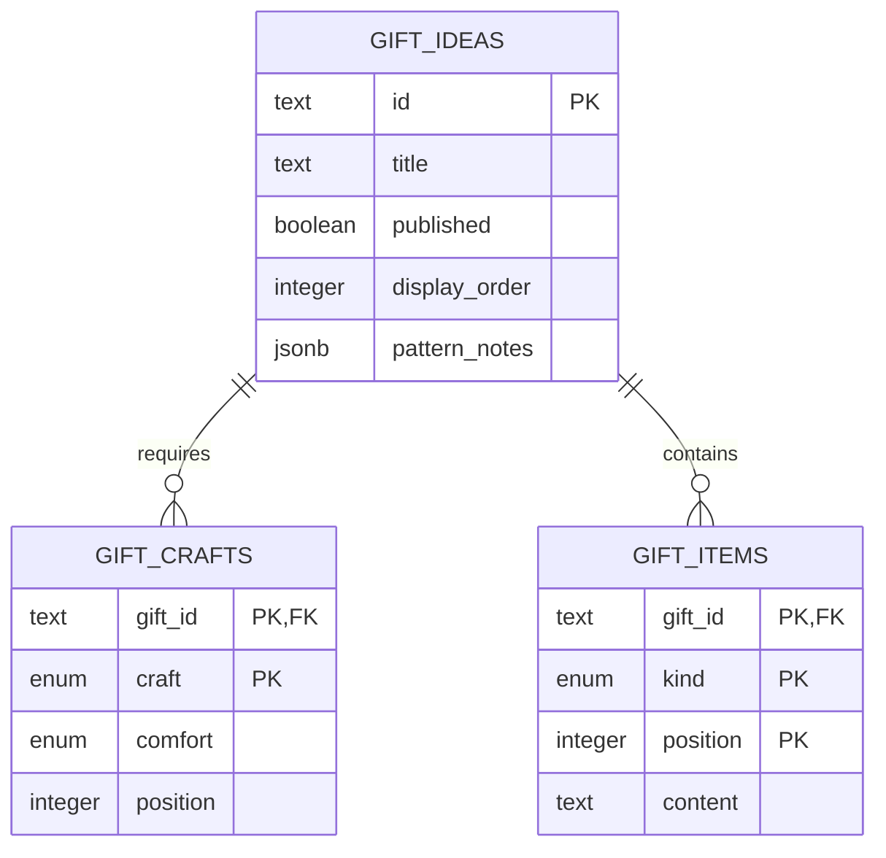
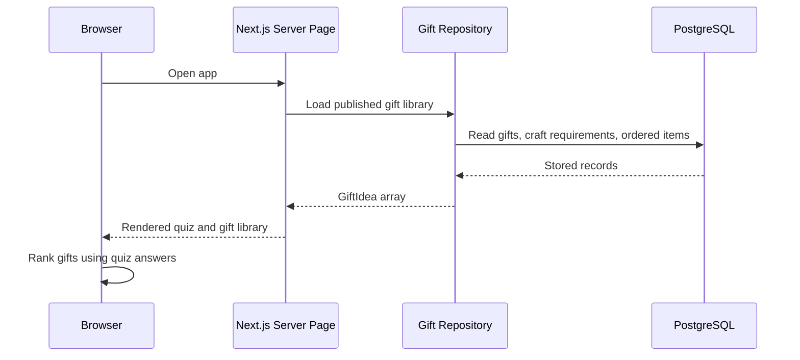

# Gift Library Database: Build And Learn

Current status: the local app is connected to hosted Supabase PostgreSQL through
the session pooler. All 33 starter gifts were imported and checked against the
original library, including pattern notes and matching results. Credentials are
stored only in the ignored `.env.local` file. A private single-owner editor is
implemented; public database-backed deployment and multi-user accounts remain future work.

The app now supports three explicit data sources:

| Mode | Where the gift library lives | Use |
| --- | --- | --- |
| `starter` | `src/lib/gift-ideas.ts` | Offline/static previews |
| `pglite` | `.data/made-for-them` on this computer | Local PostgreSQL development |
| `postgres` | A PostgreSQL server, including Supabase or Neon | Hosted database |

PGlite is an embedded PostgreSQL engine, not a hosted database or the full
Supabase stack. It gives us local persistence and PostgreSQL tests without Docker.
The same SQL migrations and repository queries are used with hosted PostgreSQL.

## 1. Understand The Tables

The definitions are in `src/db/schema.ts`.

- `gift_ideas` holds each gift's identity, description, filters, photo path,
  pattern notes, publication status, and display order.
- `gift_crafts` holds each gift's craft types and required comfort levels.
- `gift_items` holds materials, tools, steps, personal touches, wrapping,
  supply categories, and retailers. Each item has a kind and position.

Positions preserve instruction and material order. Existing gift IDs are kept,
so moving the library does not change the identity of a project.
Pattern notes use JSONB to preserve gauge, abbreviations, finished size, and notes.
Enum values come from the quiz options, so the database and quiz use the same vocabulary.



## 2. Create And Fill The Local Database

To use local PGlite instead of Supabase, set `GIFT_DATA_SOURCE=pglite` and
`LOCAL_DATABASE_PATH=.data/made-for-them` in the ignored `.env.local` file.
New checkouts can create this file using the values in `.env.example`.

Stop the development server before any command that opens the file database.
PGlite's file database must be opened by only one process at a time.

```sh
pnpm db:setup
pnpm db:check
pnpm dev
```

`db:setup` applies versioned SQL migrations, then imports the starter library.
It only inserts missing gift IDs: existing content edits and publication choices
are preserved. It does not refresh existing records from the TypeScript file.
The whole import runs in a transaction, so a failed import leaves no partial gifts.

Do not delete `.data` as a routine reset: it contains local database content.
The folder and `.env.local` are excluded from Git.

## 3. Follow A Gift Through The App



`src/lib/gift-library.ts` is server-only. It selects the data source and reuses
the database connection. `src/db/gift-repository.ts` reconstructs `GiftIdea` objects.
`src/app/page.tsx` passes those objects to the interactive app as a prop.
The browser still runs the existing matching algorithm, but no longer imports
the starter library directly. Database credentials never go to the browser.

Database mode reads fresh data on page requests. Refresh after a content edit.
Configured database failures show a retry screen; they do not silently switch to starter data.

## 4. Move To Supabase

1. Create a free Supabase project named `Made For Them`. Choose a region near
   the app's eventual server and retain the database password privately.
2. In the project's **Connect** panel, get a PostgreSQL connection string.
   A session pooler connection is useful for local access and migrations on
   IPv4 networks. Use a transaction pooler for a serverless deployment.
3. Stop the dev server. In `.env.local`, set `GIFT_DATA_SOURCE=postgres`,
   `DATABASE_URL` to the app connection, and `MIGRATION_DATABASE_URL` to the
   migration connection. Use the connection details shown for that project;
   URL-encode special password characters. Use SSL as documented by Supabase.
4. Run `pnpm db:setup`, then `pnpm db:check`, then `pnpm dev`.
5. Inspect the three tables in Supabase's Table Editor and verify the app.

No Supabase API key or browser SDK is needed for this database-only milestone.
`postgres` and Drizzle connect from the Next.js server. Authentication and
Supabase Storage can be introduced later, separately.

Row level security is enabled with no public policies. This prevents anon or
authenticated API users from reading or changing these tables. Setup uses the
database owner connection, which can access its own tables. Before a public
launch, configure a dedicated read-only app role and a published-content read
policy for that role; keep migration credentials separate from the deployed app.
The [owner editor](admin-editor.md) uses authenticated server routes for writes.

Do not put connection strings in chat, Git, or `NEXT_PUBLIC_` variables.
The deployment host also needs private environment settings and a Next.js
server runtime. GitHub Pages cannot run this backend.

Official references: [Supabase connections](https://supabase.com/docs/guides/database/connecting-to-postgres),
[Supabase pricing](https://supabase.com/pricing),
[Drizzle PGlite](https://orm.drizzle.team/docs/connect-pglite).

## 5. Verify And Evolve

```sh
pnpm test:db
pnpm lint
pnpm build
```

Tests use isolated PostgreSQL engines and temporary directories, not your local
gift library. They check full content round trips, matching parity, drafts,
repeatable imports, transaction rollback, constraints, RLS, and persistence.
They do not verify hosted networking, SSL, or Supabase-specific roles.

For future schema changes: edit `schema.ts`, run `pnpm db:generate`, inspect the
generated SQL, then run `pnpm db:migrate` with the app stopped locally. Migrations
are committed; the database file and credentials are not. Never edit an applied migration.

`pnpm build` creates the database-enabled server build when a database mode is
configured. With no configured mode it creates a static starter preview.
`pnpm build:github-pages` and `pnpm build:static` always use starter data and
produce static snapshots, not live database versions. These builds remain shareable
without needing your private local database.

Local development is ready when migrations and the import succeed, the app
renders the database library, and tests pass. User accounts, saved-idea sync,
analytics, and public database-backed deployment remain separate work.
